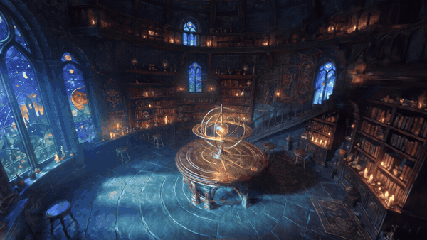
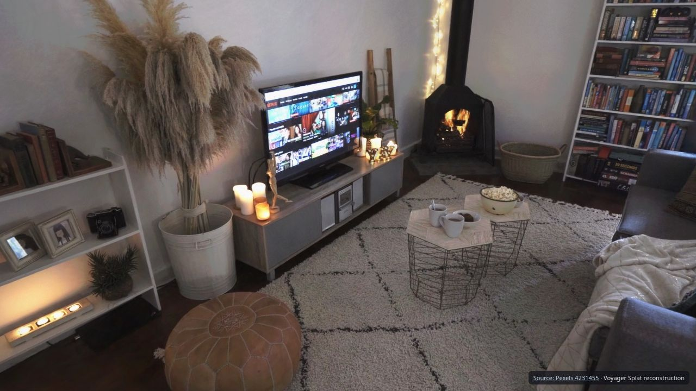
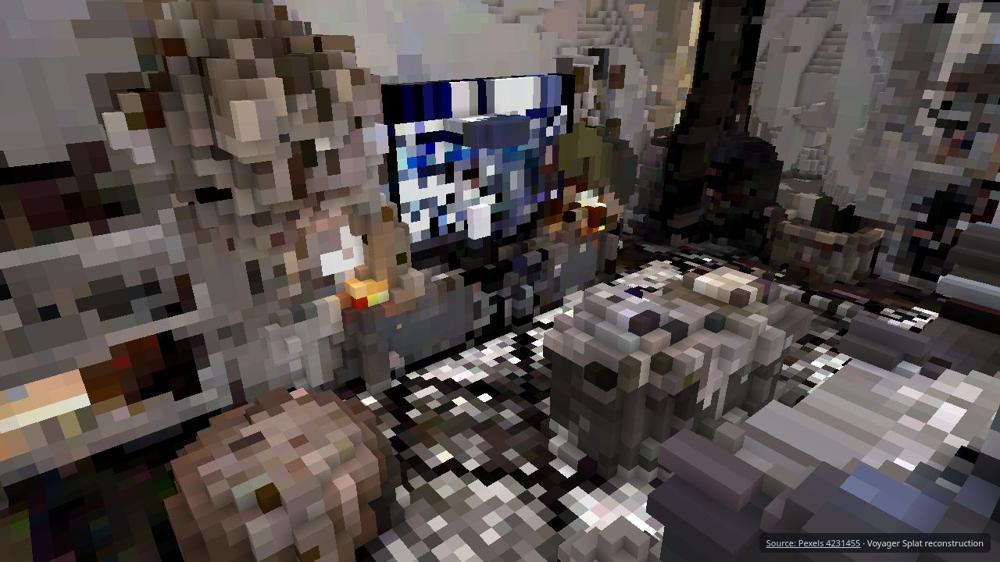
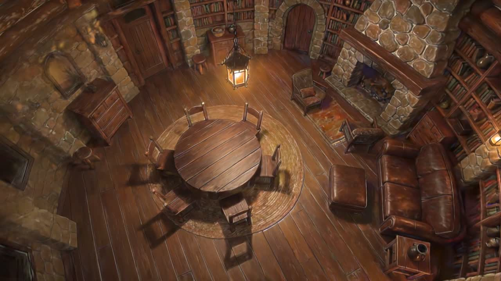
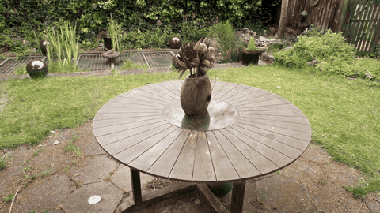
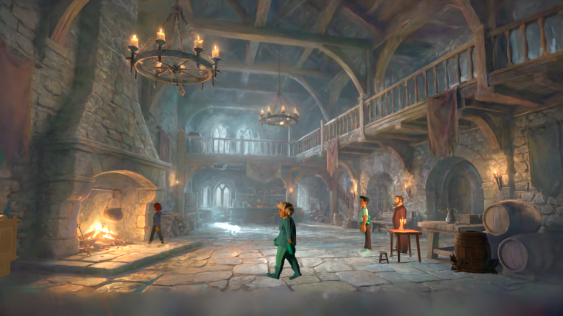
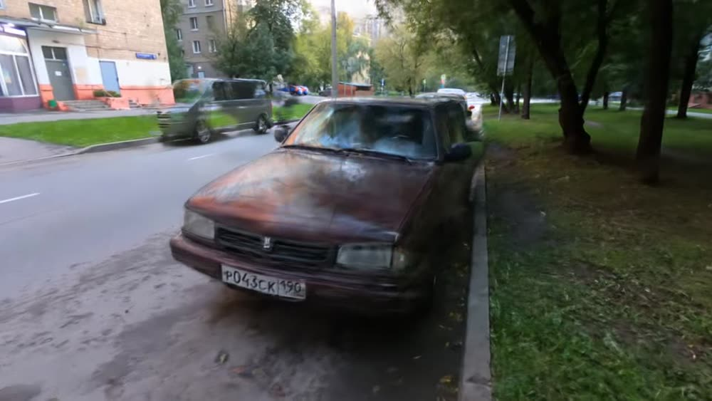
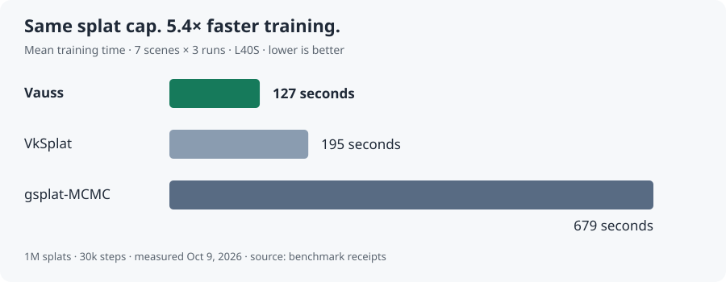

# Vauss

### Better splats. 5.4× faster.

[](https://github.com/voyager-so/vauss/actions/workflows/ci.yml) [](LICENSE) [](#bring-it-into-blender-53) [](#one-command-on-voyager-cloud)

**The fastest Gaussian splat trainer. 5.4× faster training than gsplat-MCMC, with better perceptual quality on all seven comparison scenes. About half the GPU memory.** Built for you and your agent.

Give it a video. Get a world you can explore, film, bring into Blender—or turn into a playable voxel level.

[](docs/launch/library.gif)

*Picture 2 World: an AI image becomes a video, then a 3D library with roughly two million splats. New cameras. New lighting. The same world.*

**3–6 minutes of training per scene on one GPU. 28.5 PSNR across nine standard scenes.** The library above went from AI image to finished Blender production in about **35 minutes**. [Measurement details](docs/launch/BENCHMARKS.md).

[Get started](#quickstart) · [Use your agent](#built-for-agents) · [Try Voyager Cloud](https://voyager.so/cloud) · [See the gallery](#gallery) · [Benchmarks](#benchmarks)

## What it is / when to use it

A Gaussian splat is a scene made from millions of tiny coloured 3D brushstrokes. Vauss learns where to put them from overlapping views, capturing the light, texture and detail of a place. The CLI handles frame selection, camera solving, GPU training, evaluation and export. You bring the footage; it builds the scene.

- **Capture a place.** Turn a slow phone video into a room, location or product you can explore.
- **Build an AI world.** Generate a coherent video from an image, reconstruct it, then direct your own shots.
- **Make a set for Blender.** Combine the captured environment with lights, props and animation.
- **Find a new camera move.** Render an orbit, push-in or walkthrough from your reconstruction.
- **Prototype a game environment.** Turn your capture into a first-person voxel world, or export collision geometry for your engine.
- **Give your agent a 3D tool.** Claude Code, Codex and MCP clients can drive the same pipeline as the CLI.

## Quickstart

### 1. Install and check your GPU

On Linux x64 or macOS arm64, install the published preview:

```sh
curl -fsSL https://raw.githubusercontent.com/voyager-so/vauss/main/scripts/install.sh | sh -s -- 0.1.21-rc
export PATH="$HOME/.local/bin:$PATH"
```

For Windows, or to install manually, download the matching archive from [Releases](https://github.com/voyager-so/vauss/releases). Keep the extracted folder together—including `tools/` and the license notices—and add the folder containing `vauss` to your PATH.

```sh
vauss doctor
```

The primary executable is **`vauss`**; `splat` and `voyager-splat` remain silent compatibility aliases. Voyager Cloud ships the same **`vauss`** CLI and compatibility aliases. A GPU with 8 GB memory, 16 GB system RAM and several CPU cores is a good starting point.

<details>
<summary>Build from source</summary>

Install a current Rust toolchain, then:

```sh
git clone https://github.com/voyager-so/vauss.git
cd vauss
cargo build --release --locked -p splat-cli --bin vauss
./target/release/vauss doctor
```

Add `target/release` to your PATH to use the commands below. The standalone scene viewer is exported by the CLI. Helpers download on first use; the release archives bundle their reviewed helper builds. See [distribution and platform details](docs/distribution.md).

</details>

### 2. Give it a video

Film a slow, steady circuit with overlapping views. Save it as `room.mp4`, then run:

```sh
vauss run room.mp4 --goal "walk-through of my living room" --driver fixed --run-dir runs/room
```

That one command checks your capture, selects frames, solves cameras, trains the splat, evaluates held-out views and writes the exports. `--driver fixed` needs no AI account. Use `--fast` for a preview or `--max` for a larger training budget.

### 3. Explore your scene

```sh
vauss export-viewer runs/room
```

Open **`runs/room/exports/viewer/index.html`** in your browser. Move around, find a shot and share the viewer folder. The standalone viewer opens directly from disk without a server; its JavaScript dependencies load from a CDN.

**Still filming?** Run `vauss check room.mp4 --room` for a quick CPU-only check of light, sharpness, movement and room coverage, or `vauss check --guide` for capture advice. [Filming guide →](docs/filming-guide.md)

## What you get from one run

**Film your living room. Walk through it. Or make the room your next game level.**

| Make this | What you get | Command |
|---|---|---|
| **An explorable scene** | A double-click browser viewer with camera navigation. | `vauss export-viewer runs/room` |
| **A playable voxel world** | First-person movement, jumping and destructible voxels. WASD/mouse or gamepad; V switches between splats and voxels. | `vauss export-game runs/room` |
| **A Blender pack** | Full splat PLY, available textured mesh, coloured surface voxels and import instructions. | `vauss export-blender runs/room` |
| **A portable splat** | `scene.spz` and `scene.json`, ready for a web scene or Blender 5.3. | `vauss export-web runs/room --out exports/room` |
| **Game-engine geometry** | Collision mesh, convex pieces and a floor estimate, with a Unity import folder. Run after the web export above. | `vauss export-collision exports/room --unity exports/room-unity` |

A normal run writes the viewer, web scene, Blender pack and voxel game under `runs/room/exports/`; these commands rebuild or export them. Mesh and surface-voxel outputs require a successful mesh. [Output guide →](docs/outputs.md)

| Your captured room | Your voxel level |
|---|---|
|  |  |

Open **`runs/room/exports/game/index.html`**. Click to look around, use **WASD** to move, **Space** to jump and click to break voxels. These are frames from the real exported game, built from a living-room video. [Media credits](docs/launch/CREDITS.md).

### Keep directing after the capture

Use **`vauss shot`** to render a new orbit or push-in and **`vauss stabilize`** to re-render shaky footage along a smooth camera path. Our car example rendered and encoded an eight-second orbit in **19 seconds** after training. [Commands and results →](examples/camera-moves/README.md)

Use **`vauss ad`** to plan and assemble a five-shot product film. The first invocation writes a plan for review; the second renders and generates the shots. This optional workflow uses paid hosted generation through your own fal.ai account. See the [command-line definition](crates/splat-shots/src/cli.rs) and `vauss ad --help`.

## Built for agents

**“Turn room.mp4 into a 3D scene, export a viewer, and bring it into Blender.”**

Let an installed, logged-in Codex or Claude Code agent drive the workflow:

```sh
vauss run room.mp4 --goal "an explorable 3D scene" --driver codex --run-dir runs/room
# Or use --driver claude.
```

Your agent gets typed tools for capture, cameras, training, evaluation, geometry and shots. Tools return structured results and images, so the agent can inspect the reconstruction as it works. The fixed pipeline, CLI tools and MCP server share the same implementation.

For your own MCP client, initialize a run and launch the stdio server:

```sh
vauss init room.mp4 --goal "an explorable 3D scene" --run-dir runs/room
vauss serve --run-dir runs/room
```

The server uses stdout for MCP and stderr for logs. `vauss tools` lists the tools; `vauss --json tools` prints their schemas. [Agent and MCP setup →](docs/agents.md)

## One command on Voyager Cloud

**Vauss and Blender 5.3 are preinstalled, side by side.** Open [Voyager Cloud](https://voyager.so/cloud), start a GPU machine with the creative image, upload your clip, and run:

```sh
vauss run room.mp4 --goal "walk-through of my living room" --driver fixed --run-dir runs/room
```

Or ask the machine's agent to reconstruct the video and import the result into Blender. The commands in this README work unchanged; use `blender-5.3` for the Blender executable. Run `vauss doctor` to inspect the GPU and helper setup. `splat` and `voyager-splat` remain compatibility aliases.

## Bring it into Blender 5.3

```sh
vauss export-web runs/room --out exports/room
```

In Blender 5.3, choose **File → Import → SPZ** and open `exports/room/scene.spz`. On Voyager Cloud you can also import and save the scene from the terminal:

```sh
blender-5.3 --background --python-expr 'import bpy; bpy.ops.wm.spz_import(filepath="exports/room/scene.spz"); bpy.ops.wm.save_as_mainfile(filepath="room.blend")'
```

Now you have a set to shoot in. Add a camera, place props and compose the shot. The relit library demo uses a custom diffuse/emission material, new lights and cleanup of stray splats; use Cycles for that mixed scene.

## Gallery

| An image becomes a set | Garden, down to the leaves |
|---|---|
|  |  |
| **1.95 million splats. 5m22s of training.** The cabin began with a Seedream 5 Pro image and Kling 4 camera moves. | **Capture once. Keep finding new shots.** Garden from Mip-NeRF 360, reconstructed with Vauss. |
| **Populate the world** | **Real footage, new cameras** |
|  |  |
| A generated tavern becomes a mixed splat-and-mesh scene in Blender. | A 41-second car walk-around becomes a scene you can film again. |

[Full media credits and source attribution](docs/launch/CREDITS.md).

### Try an example

Download the original [Moskvitch car video](https://commons.wikimedia.org/wiki/File:Moskvitch-2142_walk_around.webm), by **trolleway, CC BY 3.0**, and save it as `moskvitch.webm`:

```sh
vauss run moskvitch.webm --goal "a 3D scene of the car" --driver fixed --run-dir runs/car
vauss export-viewer runs/car
```

Open `runs/car/exports/viewer/index.html`. The [examples guide](examples/README.md) includes room captures, textured meshes, camera moves and an agent-driven pipeline, with commands, source downloads, timings and credits. For garden, bicycle and the other standard scenes, see the original [Mip-NeRF 360 dataset](https://jonbarron.info/mipnerf360/).

## Why it's fast

Vauss builds on [Brush](https://github.com/ArthurBrussee/brush), Arthur Brussee's portable GPU splatting engine. We have pushed on the whole training path: GPU sorting and rasterization, fused operations, buffer reuse and scene-adaptive training budgets.

The engine is native Rust, built with Burn, CubeCL and wgpu. It runs through Vulkan, Metal or DX12, without requiring CUDA for the trainer. The result is a faster creative loop: reconstruct a scene, inspect it, change the budget and try again.

## Benchmarks

### Same splat cap. 5.4× faster training.

Seven Mip-NeRF 360 scenes × three runs, paired on L40S GPUs, with a **1M-splat cap and 30,000 steps**. Vauss had **lower LPIPS perceptual error on all seven scenes** than gsplat-MCMC, while using **0.43–0.56× its GPU memory**.

| Trainer | Mean training time |
|---|---:|
| **Vauss** | **127 seconds** |
| VkSplat | 195 seconds |
| gsplat-MCMC 1.5.3 | 679 seconds |



### Detailed scenes in minutes

Our tuned native recipe reaches **28.521 PSNR** across all nine Mip-NeRF 360 scenes, with **195–342 seconds of training per scene** on one RTX PRO 6000.

| Dataset / recipe | Scenes | PSNR ↑ | SSIM ↑ | LPIPS ↓ |
|---|---:|---:|---:|---:|
| **Mip-NeRF 360 · tuned** | **9** | **28.521** | **0.8375** | **0.2079** |
| Mip-NeRF 360 · three-run reference | 9 | 28.127 | 0.8311 | 0.2226 |
| Tanks & Temples · three-run reference | 2 | 24.365 | 0.8693 | 0.1562 |
| Deep Blending · three-run reference | 2 | 30.346 | 0.9126 | 0.2915 |

PSNR and SSIM measure agreement with withheld photos; higher is better. LPIPS measures perceptual difference; lower is better. [Methodology](docs/launch/BENCHMARKS.md) · [Numeric results](docs/launch/measurements.json).

## Documentation and contributions

[Commands](docs/commands.md) · [Outputs](docs/outputs.md) · [Agents and MCP](docs/agents.md) · [Filming guide](docs/filming-guide.md) · [Examples](examples/README.md)

Bug reports and focused improvements are welcome. Read [CONTRIBUTING.md](CONTRIBUTING.md); report security issues through [SECURITY.md](SECURITY.md).

## License and credits

Original Vauss code is **source available under the [Vauss Preview License](LICENSE)**, free to use during the research preview, including commercial work and private modifications. It is not open source. The license limits modified distribution and hosted services; see the full terms for those uses.

**Upstream rights stay intact.** The Brush-derived `crates/splat-train*` remain Apache-2.0, including their modifications. The Depth Anything 3 / DINOv2 port in `crates/splat-sfm-learned` remains Apache-2.0, with its JPEG implementation under the IJG license; `crates/splat-eval/src/color.rs` remains Apache-2.0. Marked code and per-scene configurations derived from Efficient Gaussian Appearance remain Apache-2.0. Vendored CubeCL remains MIT OR Apache-2.0. These components are excluded from the Preview License. Other dependencies, tools, model weights and example media retain their own terms.

Built on **Brush by Arthur Brussee and contributors**, with [Burn](https://github.com/tracel-ai/burn), [CubeCL](https://github.com/tracel-ai/cubecl) and [wgpu](https://github.com/gfx-rs/wgpu). See [NOTICE](NOTICE) and the [Brush-derived engine notices](crates/splat-train/NOTICE) for attribution. Bundled tools and optional integrations retain their individual notices and terms.

Benchmark datasets: **Barron et al., Mip-NeRF 360; Knapitsch et al., Tanks and Temples; Hedman et al., Deep Blending.** Car footage: **trolleway, CC BY 3.0**. [Gallery credits](docs/launch/CREDITS.md) · [Example data credits](examples/DATA.md).

## Fine print

- **Benchmarks:** measured October 9, 2026. The 5.4× speedup is `1 / 0.185`, the mean paired time ratio; the table shows rounded arithmetic means. It compares equal splat caps, not every method at every quality target. The tuned nine-scene quality result uses a separate recipe and one seed; the reference results use three runs. [Full methodology](docs/launch/BENCHMARKS.md).
- **Timing:** 3–6 minutes means training. Video preparation, camera solving and export take additional time. The library's roughly 35-minute production also includes AI generation and final rendering; its video-to-exports stage took 11m52s. The cabin used a different workflow and took 36m55s from video to exports.
- **Scenes:** quality is strongest near the captured views. Unseen surfaces, moving objects, mirrors and thin structures can produce artifacts. Relighting is an artistic material workflow, not recovered physical materials. Use ordinary SPZ for Blender; neural-colour research files need their matching renderer.
- **Platforms and extras:** performance has been measured on NVIDIA; Apple M4 has a smoke test, while AMD/Intel performance and full Windows release validation remain open. The fixed pipeline needs no AI account. Agent drivers use your own agent login; optional hosted generation uses your `FAL_KEY` and the provider's pricing and terms.
