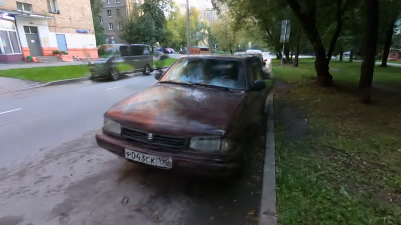
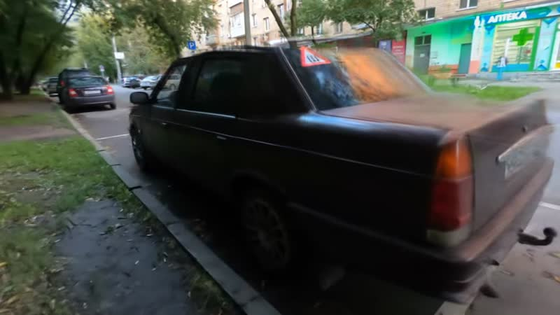
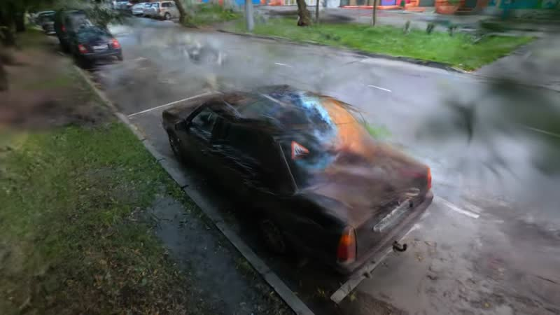
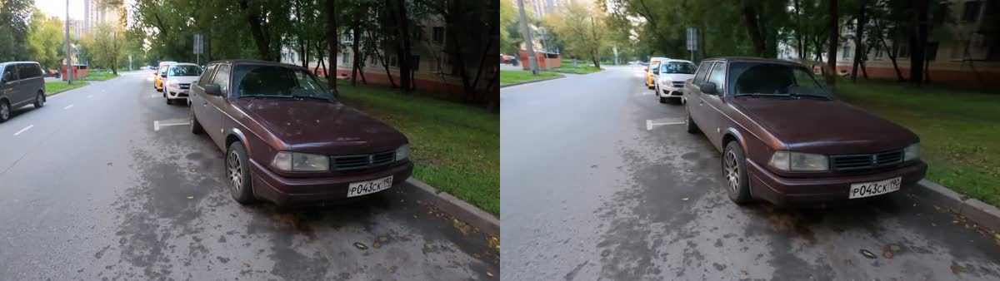

# Designed camera moves through a splat

Once a scene is trained, `vauss shot` plans a camera move from a plain-English prompt (orbit, push-in, crane…),
checks how far it strays from where the video was filmed, and renders it. `vauss stabilize` re-renders the
capture's own path, smoothed and levelled. This example uses the 41-second car walk-around from
[car-mesh](../car-mesh/README.md).



## Clip

"Moskvitch-2142 walk around" by [trolleway](https://www.youtube.com/user/trolleway),
[Wikimedia Commons](https://commons.wikimedia.org/wiki/File:Moskvitch-2142_walk_around.webm),
[CC BY 3.0](https://creativecommons.org/licenses/by/3.0).

## Commands

```sh
curl -fsSL -o moskvitch.webm \
  "https://upload.wikimedia.org/wikipedia/commons/c/c4/Moskvitch-2142_walk_around.webm"
vauss run moskvitch.webm --goal "3D scene of the car" --driver fixed --run-dir runs/car-scene

# The trained splat and the camera solve it was trained on (jq: https://jqlang.org).
R=runs/car-scene
CAND=$(jq -r '.deliverables.splat | split("/")[1]' $R/report.json)
SFM=$(jq -r ".artifacts[\"$CAND\"].meta.sfm_id" $R/state.json)
PLY=$R/artifacts/$CAND/splat.ply; DATA=$R/artifacts/$SFM

vauss shot --ply $PLY --data $DATA --out shots/orbit   --prompt "slow orbit around the car, 8s"
vauss shot --ply $PLY --data $DATA --out shots/push-in --prompt "slow push-in toward the front of the car, 5s"
vauss shot --ply $PLY --data $DATA --out shots/crane   --prompt "crane up over the car, 6s"
vauss stabilize --ply $PLY --data $DATA --out shots/stabilized --video moskvitch.webm
splat review --out shots/review shots/orbit shots/push-in shots/crane shots/stabilized
```

Each shot folder holds `path.json` (the camera path), `risk.json` (how far each frame is from the filmed cameras)
and `render/` with `rgb.webm`, `depth.webm` and `alpha.webm` plus the individual frames. The bundled FFmpeg is an LGPL
build without H.264, so videos are WebM (VP9). `splat review` writes an HTML page in `shots/review/` that plays them side by side.
`vauss stabilize` also cuts the matching stretch of the original clip (`capture.webm`) for a before/after.

An agent can do the same through MCP with `plan_shot` and `render_shot`; see [agent-mcp](../agent-mcp/README.md).

## Result

| Shot | Frames | Render time | Risk (largest distance from a filmed camera, scene units) |
|---|---|---|---|
| Orbit, 8 s | 192 | 19 s | medium (0.30) |
| Push-in, 5 s | 120 | 11 s | low (0.20) |
| Crane up, 6 s | 144 | 13 s | medium (0.35) |
| Stabilized capture path, 39 s | 940 | 1 min 59 s | medium (0.28 at the worst frame, 0.02 on average) |

Render times include writing PNGs and encoding the WebM videos.







*Left: the original video. Right: the stabilized re-render of the same moment.*

## Time and hardware

Measured on 2026-10-24 with splat built from `main` at `bea9145d` on an NVIDIA RTX PRO 6000 Blackwell (96 GB),
6 CPU cores. The splat came from the same default pipeline, run through the MCP server in the
[agent-mcp example](../agent-mcp/README.md) (`run_default_pipeline`, 9 min end to end). The shots peaked at
0.6 GiB of GPU memory.

## Limits seen here

- The crane rises above where anyone held the camera, so the car roof and the trees above it break up into
  floaters near the top of the move. `risk.json` flags frames like that before you look.
- Moves through a room filmed as short separate shots look much worse than this. We tried the same moves on the
  [room-walk](../room-walk/README.md) clip and the frames were mostly haze. Pick a capture that circles the subject.
- `--model` sends a render to hosted video models to restyle or clean it up. That needs a fal.ai key (`FAL_KEY`),
  costs money, and was not run here.
