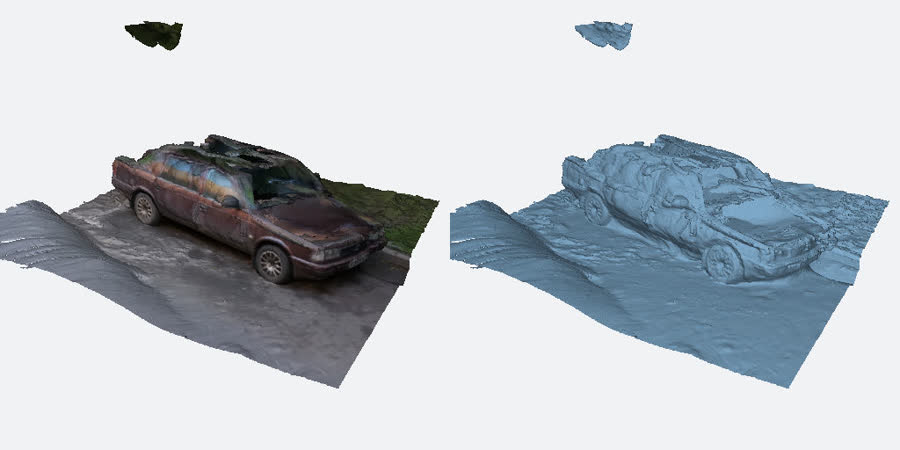
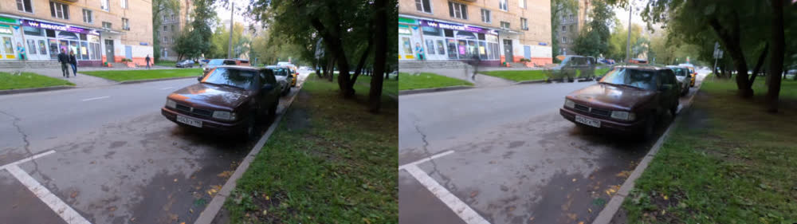
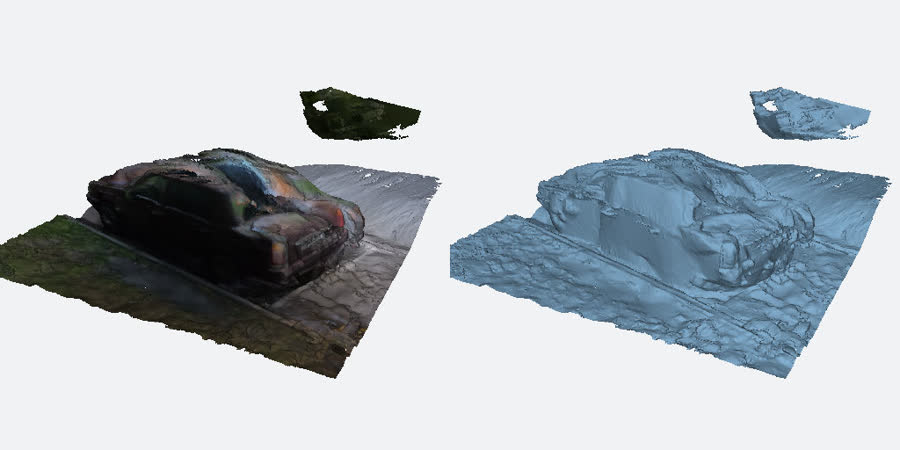

# Car walk-around → textured mesh

A 41-second handheld walk around a parked car becomes a textured mesh (GLB) and a splat, with one command.



*Left: the textured mesh. Right: the same geometry without texture. Rendered by splat's mesh preview.*

## Clip

"Moskvitch-2142 walk around" by [trolleway](https://www.youtube.com/user/trolleway),
[Wikimedia Commons](https://commons.wikimedia.org/wiki/File:Moskvitch-2142_walk_around.webm),
[CC BY 3.0](https://creativecommons.org/licenses/by/3.0). 41 s, 3840×2160, VP9, one full loop around the car.

## Commands

```sh
curl -fsSL -o moskvitch.webm \
  "https://upload.wikimedia.org/wikipedia/commons/c/c4/Moskvitch-2142_walk_around.webm"

vauss check moskvitch.webm
vauss run moskvitch.webm --goal "textured mesh of the car" --driver fixed --non-interactive --run-dir runs/car
```

The word "mesh" in the goal makes the fixed pipeline train flat surfels (2D Gaussian splatting), which gives
cleaner surfaces to mesh than ordinary 3D Gaussians. `--non-interactive` stops it from asking questions; leave
it out when you run it yourself.

## Result

| | |
|---|---|
| Camera solve | 206 of 206 frames placed |
| Held-out frames | 26 (every 8th frame, never trained on); 180 frames trained |
| PSNR / SSIM / LPIPS (VGG) | 23.8 dB / 0.826 / 0.162 |
| Mesh | `runs/car/artifacts/mesh_*/mesh.glb`, 56 MB with a 2048 px texture |

LPIPS ran on the CPU on images downscaled to 512 px (the machine had no ONNX Runtime GPU provider).



*A held-out frame (left) and the render from the same camera (right).*



Open the outputs:

```sh
vauss view runs/car                         # the splat in the browser
open runs/car/exports/viewer/index.html     # double-click viewer, no server
# runs/car/exports/blender/ has mesh.glb, the splat PLY, voxels and Blender import steps
```

## Time and hardware

Measured on 2026-10-24 with splat built from `main` at `bea9145d`, on a cloud Linux machine: NVIDIA RTX PRO 6000
Blackwell (96 GB), 6 CPU cores. Peak GPU memory, sampled every 2 s: 3.3 GiB.

| Stage | Time |
|---|---|
| Probe the 4K video | 28 s |
| Pick frames | 18 s |
| Camera solve (COLMAP global mapper, CPU) | 7 min 2 s |
| Training (7,000 steps, surfels) | 1 min 32 s |
| Held-out evaluation | 18 s |
| Mesh | 59 s |
| Viewer, Blender pack and game exports | 1 min 36 s |
| **Total** | **12 min 13 s** |

The released 0.1.19-rc binary ran the same clip in 8 min 46 s (incremental camera solve 3 min 55 s, 150
training frames) to PSNR 22.2 / LPIPS 0.254. Main's global solve takes longer on this clip and trains on every
frame, which scores better.

## Limits seen here

- The car is glossy. Reflections move as the camera moves, so the paint and windows come out mottled in the
  texture and the roof surface is lumpy.
- The mesh includes the pavement, kerb and grass around the car. Crop it in Blender if you want the car alone.
- People walking past appear in some frames; they are averaged away in training but can leave faint smears.
  For busy scenes, a goal such as "…, remove people" makes the AI drivers mask them first (`mask_distractors`).
