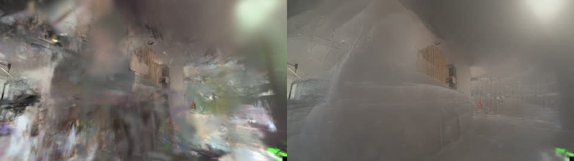
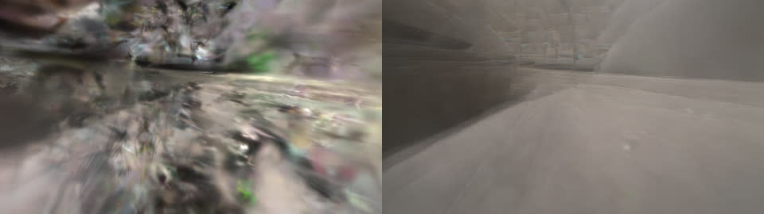

# Fill in a room away from the filmed path

A splat is sharp along the path the camera walked and turns to haze and floaters to the side of it. `vauss fill`
renders new views on the free floor near the path, repairs them with a diffusion "fixer" model (NVIDIA Fixer by
default), and trains the repaired views back in at low weight next to the real frames. The method and its knobs
are in [docs/fill.md](../../docs/fill.md).

This example runs it on the room from [room-walk](../room-walk/README.md), after `vauss refine --max`.



*Left: a novel view rendered from the splat. Right: what NVIDIA Fixer made of it. This is one of the 600 views
trained back in.*

## Commands

```sh
# Once per machine: the fixer's Python environment and the 5.5 GB NVIDIA Fixer weights (Linux, NVIDIA GPU).
bash crates/splat-fill/fixer/setup_fixer.sh
# it prints the variables to export: FIXER_SRC, FIXER_MODELS, and the --fixer-python path

vauss fill runs/room-max --fixer-python ~/.local/share/splat-fixer/venv/bin/python --limit 600
```

The new splat is `runs/room-max/fill/model/splat.ply`. `runs/room-max/fill/fill.json` records the inputs, the
number of views, the time of each stage and the held-out scores. `fixer.json` records which model repaired the
views, with its checkpoint hash and license.

`--limit 600` keeps a random 600 of the planned views so the example runs in minutes. Without it, all views
within 1 m of the path are used (here 17,259 cameras were planned).

## Result

| | Before (`--max` model) | After `vauss fill` |
|---|---|---|
| Held-out PSNR (on-path frames, trainer metric) | 19.78 dB | 19.76 dB |
| Held-out SSIM | 0.767 | 0.766 |
| Training views | 200 real | 200 real + 600 repaired novel views |

The held-out frames lie on the filmed path, so these scores only show that the fill did not damage it. Fill
targets views away from the path, which these scores do not measure. On this clip the base model is weak away
from the path (see room-walk), and the fixer mostly turns its broken renders into smooth haze rather than a
recognisable room. Expect most from fill on a capture that is already sharp along its path. Off-path measurements on a
larger model of this room, and where `vauss fill` does and does not match the research loop it is ported from, are in
[docs/fill.md](../../docs/fill.md#results-public-room-measured).



## Time and hardware

Measured on 2026-10-24 with splat built from `main` at `bea9145d` on an NVIDIA RTX PRO 6000 Blackwell (96 GB),
6 CPU cores. Peak GPU memory, sampled every 2 s: 3.9 GiB.

| Stage | Time |
|---|---|
| Fixer environment and weights (`setup_fixer.sh`, first time, fast datacenter link) | 18 s |
| Plan cameras on the free floor | 1 min 51 s |
| Render 600 views | 10 s |
| Repair them with NVIDIA Fixer | 2 min 20 s |
| Confidence maps | 45 s |
| Train 6,000 steps | 1 min 11 s |
| **Total `vauss fill`** | **6 min 17 s** |

## License note

NVIDIA Fixer's code is Apache-2.0. Its weights are under the NVIDIA Open Model License, which allows commercial use
and asks for "Built on NVIDIA Cosmos" attribution where it applies. The alternative `--fixer difix-ref` is
**non-commercial only**. See [docs/fill.md](../../docs/fill.md#fixers-and-licences).
