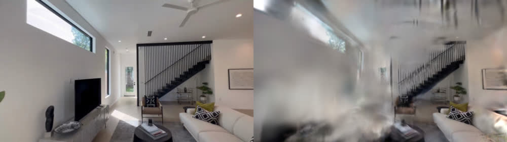
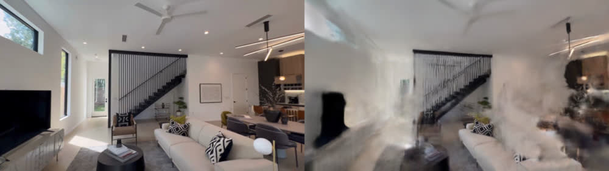

# Phone room walk → walk-anywhere viewer

Fifty seconds of handheld iPhone video of an open-plan living room, dining area and kitchen becomes a splat you
can walk through in the browser.



*Left: a frame the model never trained on. Right: the splat rendered from that frame's camera.*

## Clip

"iPhone 14 Pro Max | Dolby HDR 4K | Austin Texas | Luxury Real Estate" by
[Showing Austin](https://www.youtube.com/channel/UCC6TrWjxg9dD9S5kDBkqePg),
[YouTube](https://www.youtube.com/watch?v=cpl03Le0uCA), [CC BY](https://creativecommons.org/licenses/by/4.0/).
We use 50 seconds starting at 0:16, without audio. It is shot on the iPhone's ultrawide lens as a series of
short handheld moves through one large room.

## Commands

```sh
# Get the clip (yt-dlp: https://github.com/yt-dlp/yt-dlp), then cut 50 s from 0:16.
yt-dlp -f "bv*[height<=1080][vcodec^=avc1]" -o austin-full.mp4 "https://www.youtube.com/watch?v=cpl03Le0uCA"
ffmpeg -ss 16 -t 50 -i austin-full.mp4 -an -c:v copy austin-room.mp4

vauss check austin-room.mp4 --room
vauss run austin-room.mp4 --goal "walk-through of an open-plan living room" --driver fixed --run-dir runs/room

# Open it: a double-click viewer, or the local server.
open runs/room/exports/viewer/index.html
vauss view runs/room
```

`vauss check` passed every line for this clip (light, sharpness, movement, detail, speed). Its coverage line noted
that a few directions were only glimpsed for 0–3 seconds.

## In the viewer

The exported viewer opens in **walk** mode at a capture position. You stand at eye height on the reconstructed
floor: drag to look, WASD/arrows or the scroll wheel to move, right-drag to slide. A collision body keeps you out
of walls and furniture and lets you step over low obstacles. Nothing ties you to the filmed path. O switches to
orbit/fly, R resets, and the view picker jumps to named capture views. Details: [docs/outputs.md](../../docs/outputs.md#viewers).

## Result

| | Default run | After `vauss refine runs/room --max --run-dir runs/room-max` |
|---|---|---|
| Frames placed by the camera solve | 229 of 251 | (same cameras) |
| Training | 7,000 steps, 1.0M splats | early-stopped at 32,250 of 45,000 steps, 2.06M splats |
| Held-out frames | 29 | 29 |
| PSNR / SSIM | 20.0 dB / 0.783 | 19.8 dB / 0.766 |
| LPIPS (VGG) | 0.388 | 0.363 |

LPIPS ran on the CPU on images downscaled to 512 px. The full-quality refine looks somewhat sharper (lower
LPIPS) but does not raise PSNR on this clip. The camera solve, not training, limits it.



## Time and hardware

Measured on 2026-10-24 with splat built from `main` at `bea9145d`, on a cloud Linux machine: NVIDIA RTX PRO 6000
Blackwell (96 GB), 6 CPU cores. Peak GPU memory, sampled every 2 s: 0.86 GiB (default), 1.3 GiB (`--max`).

| Stage | Time |
|---|---|
| Probe and pick frames | 13 s |
| Camera solve (COLMAP global mapper, CPU) | 22 min 10 s |
| Training (7,000 steps) | 50 s |
| Held-out evaluation | 55 s |
| Mesh | 34 s |
| Viewer, Blender pack and game exports | 2 min 9 s |
| **Total** | **26 min 51 s** |
| `vauss refine --max` (training, evaluation, mesh, exports) | 9 min 27 s |

The camera solve runs on the CPU and dominates: on 6 cores it is 83% of the run. More CPU cores help it; a faster
GPU does not. See [docs/performance.md](../../docs/performance.md).

## Limits seen here

- **This clip is hard for the camera solve.** It is a series of short shots from different spots, not one
  continuous walk, and 22 of 251 frames were not placed. The solve is also not deterministic: in three runs of this
  clip with the global solve (this one and two on a pre-merge build of the same code), held-out PSNR was 15.1,
  20.0 and 20.2 dB. A continuous one-minute walk in arcs
  (see [docs/filming-guide.md](../../docs/filming-guide.md)) solves faster and better.
- **Off the filmed path the room turns to haze.** You can walk anywhere, but a metre or two from where the camera
  went you will see floaters and smears. For the same reason, designed camera moves through this room look poor;
  the [camera-moves example](../camera-moves/README.md) uses the car clip instead.
  [room-fill](../room-fill/README.md) runs `vauss fill` on this room to train repaired views from off the path.
